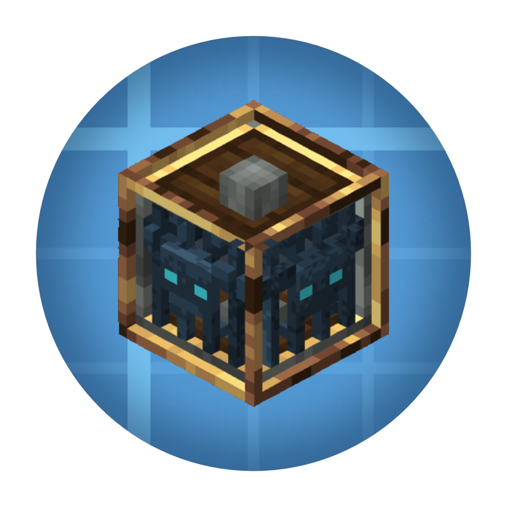

<div align="center">
  

  # Create: Mob Grinding
  
  [](https://neoforged.net/)
	<a href="https://www.curseforge.com/minecraft/mc-mods/create-mob-grinding"></a>
    <a href="https://modrinth.com/mod/create-mob-grinding"></a>

</div>

An addon for the **Create** mod that brings a kinetic way to spawn and grind mobs in Minecraft! Extract souls from Vanilla spawners and utilize rotational force to power your very own customizable mob farms.

---

## Features

- **Chunk Extraction**: Mine Vanilla Spawners with a Pickaxe to extract a **Mob Spawner Chunk** containing the soul of the mob inside.
- **Rotational Mob Spawner**: A kinetic machine that consumes Stress Units (SU) to spawn mobs with specific conditions. Upgrade to make the spawner powerful.
- **Rotational Mob Grinder**: A spinning blade to automatically eliminate mobs and gather their loot. Upgrade the Grinder with tiered blades and enchant.
- **Dynamic Tiering System**: Mobs are automatically grouped into 5 Tiers. Higher tier mobs require much more SU and time to spawn compared to lower-tier ones!
- **Configurable**: Spawn times, stress, mob caps, blade damage, chunk stacking, trades and more can be tuned in the NeoForge config. Blacklist destructive mobs (like the Warden or Ender Dragon).
- **Wandering Trader**: Occasionally sells a Scrap Spawner Chunk for 32 Emeralds.
- **Spawner Chunk Bag**: Carry up to 27 Spawner Chunks. Use the bag on a Rotational Mob Spawner and click a chunk to swap it instantly.
- **Fan Filter Upgrade**: Install it on an Encased Fan to make it ignore Items, Players or Mobs. Cycle the mode with a Wrench on the fan's front or back face, sneak + right-click with an empty hand to take it back.
- **Display Link Support**: Show a spawner's progress (percentage or progress bar) or its mob, and a grinder's kill counter, on Display Boards, Signs and Nixie Tubes.
- **Chunk Stacking**: Put up to 8 Spawner Chunks of the same mob in one spawner: it spawns faster and more mobs at once, at a higher stress cost.
- **Automation**: Funnels, Hoppers and Mechanical Arms can insert and extract Spawner Chunks. Comparators read the spawner's progress and how full the grinder's vacuum inventory is.

---

## Mod Compatibility

Mob tiers are plain entity type tags, so any mod's mobs can be tiered:
`createmobgrinding:tier_1` … `createmobgrinding:tier_5` (in `data/createmobgrinding/tags/entity_type/`).

Built-in tiers are included for **Ars Nouveau**, **Twilight Forest** and **The Aether**. They only apply when those mods are installed.

Mobs without a tier tag default to **Tier 1**. To tier another mod's mobs, add a datapack with a file like `data/createmobgrinding/tags/entity_type/tier_3.json`:

```json
{
  "replace": false,
  "values": [
    { "id": "somemod:some_mob", "required": false }
  ]
}
```

With KubeJS you can do the same from a server script:

```js
ServerEvents.tags('entity_type', event => {
  event.add('createmobgrinding:tier_3', 'somemod:some_mob')
})
```

---
## Issues and Bug Reports

Found a bug or have a suggestion? We'd love to hear it! 
Please open an issue in the **[Issues Tab](../../issues)**. 

**Important:** Please ensure you select and fill out the provided Issue Template. Bug reports that don't follow the template may take much longer to resolve.

---

## Contributions

Want to help develop the mod? We welcome contributions! 

1. Check out our **[ROADMAP.md](./ROADMAP.md)** file to see a list of known bugs to fix and future features we'd love to see implemented.
2. **Fork** this repository.
3. Implement your changes in your forked repository.
4. Open a **Pull Request** back to this main repository.

If you have your own ideas, feel free to open an Issue tagged with `enhancement` first to discuss it!

---

## Supported Languages
🇮🇹 🇺🇸 

If you want to help with translations you can find the files in: `src/main/resources/assets/createmobgrinding/lang/`, copy the base `en_us.json` file and rename it to your language code (e.g., `es_es.json` for Spanish, `fr_fr.json` for French).


